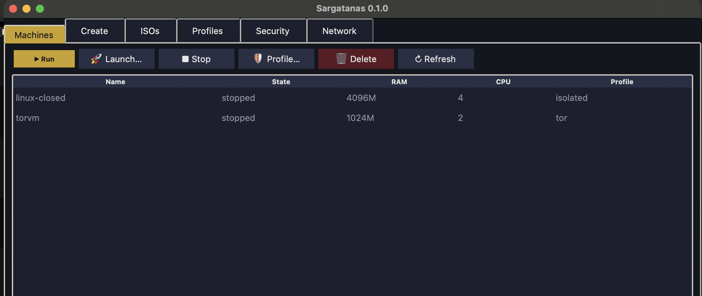
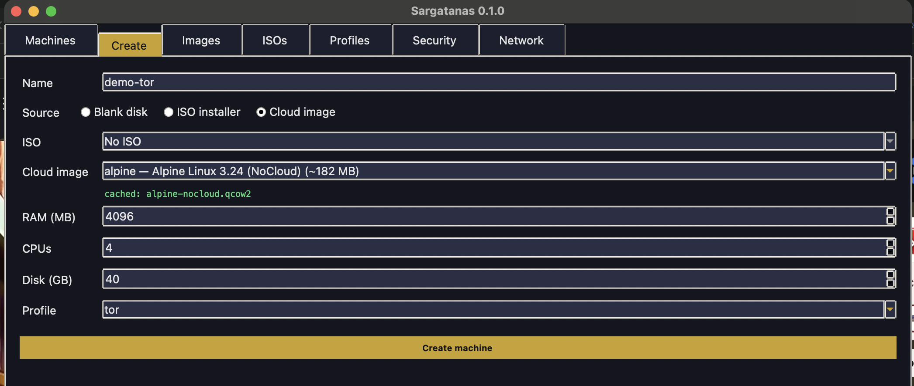
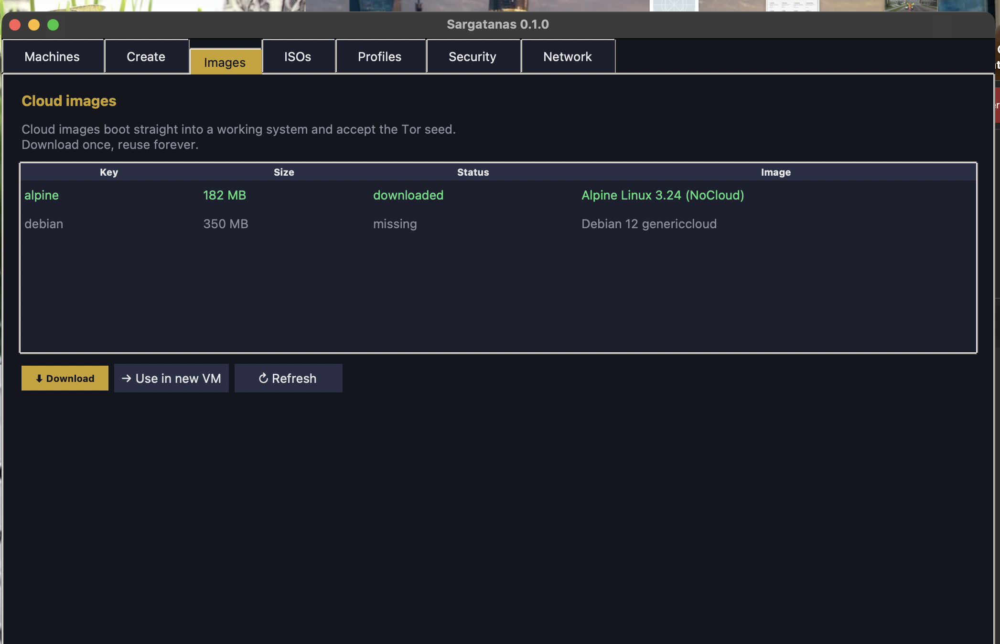

<div align="center">


# Sargatanas

**Virtual machine manager for maximum anonymity**

Privacy is a bless granted by design, do not let others decide your destiny.

<br>

[](https://github.com/azazelumbrae/sargantanas/actions)
[](https://github.com/azazelumbrae/sargantanas/releases)
[](https://www.python.org/)
[](https://www.qemu.org/)
[](#-platforms)
[](LICENSE)

<br>

[Features](#-features) •
[Security tiers](#️-security-tiers) •
[Network modes](#-network-isolation-modes) •
[Tor & VPN](#-tor--vpn) •
[Install](#-install) •
[Usage](#-usage) •
[GUI](#️-graphical-interface)

</div>

---

## 📌 What it is

**Sargatanas** turns QEMU into a fortress. Not another VM launcher — a machine
built to disappear, run from a single terminal or from a graphical interface.

Every machine is born inside a **security tier**, and that tier decides, before
the first byte boots, exactly what the machine can see, touch and leak. Pick
`isolated` and it has no network device at all — no address, no route, no
signal. Pick Tor or VPN and Sargatanas **refuses to start** if the tunnel is
down or the SOCKS listener is dead — because an anonymity layer that fails open
is not anonymity, it is a lie. Sargatanas fails closed.

No telemetry. No cloud. No account. Just you, an isolated machine, and a state
that lives entirely on your disk in one versioned file you can read.

> *"We remain unseen by those who seek our downfall; the air sustains us and the
> shadows clothe us, until the blow is struck."*

---

## ✨ Features

<table>
<tr>
<td width="50%" valign="top">

### Machine management
- Create, start, stop and delete VMs
- `qcow2` disk of any size
- Per-VM RAM and CPU count
- Live status (is it really running?)

### Flexible booting
- **Disk** — normal boot of the installed system
- **Install** — boot the ISO installer
- **Live** — boot the ISO **without touching the disk** (changes discarded)
- **Quick boot** — diskless ISO, fully disposable

</td>
<td width="50%" valign="top">

### Security
- **8 tiers** of isolation, most closed to most open
- **6 network modes** to choose from
- **Tor** and **VPN** checks before launch
- Per-tier **firewall rules**, inspectable at any time
- **QEMU sandbox** (seccomp) where the binary supports it

### Utilities
- Disk **snapshots** (`qemu-img`)
- **ISO discovery** in your usual folders
- **Tor identity rotation**
- **WireGuard** and **OpenVPN** templates
- VPN **kill switch**

</td>
</tr>
</table>

---

## 🛡️ Security tiers

From **most closed** to **most open**. Every tier declares what it checks and
what it blocks; ones that depend on an external service **refuse to start** if
they cannot be honoured.

| # | Tier | Guest network | Checks before launch | Sandbox |
|:-:|------|---------------|----------------------|:-------:|
| 1 | 🔴 **`paranoid`** | No network device (air-gap) | — | ✅ |
| 2 | 🟠 **`isolated`** | No network device (air-gap) | — | — |
| 3 | 🟣 **`stealth`** | **All TCP -> Tor** + VPN tunnel | Tor, TransPort, VPN, cloud image | ✅ |
| 4 | 🟣 **`tor`** | **All TCP -> Tor** | Tor + TransPort, cloud image | — |
| 5 | 🔵 **`vpn`** | NAT through the tunnel | **VPN** | — |
| 6 | 🟢 **`pentesting`** | Internal VM↔VM network + NAT | — | — |
| 7 | ⚪ **`nat`** | NAT with port forwards | — | — |
| 8 | ⚫ **`restricted`** | NIC present but isolated | — | — |

> **Example:** `sargatanas create lab --profile stealth` only starts if a Tor
> SOCKS listener, an active VPN interface and a cloud-init image are present.
> If any is missing, the VM is not launched.

### How Tor routing works

QEMU's user networking has no outbound-proxy option, so the traffic is
redirected **inside the guest**:

```
guest app -> iptables REDIRECT -> 10.0.2.100:9040 -> guestfwd -> host Tor TransPort
```

1. `guestfwd` splices the host's Tor TransPort (9040), SOCKS (9050) and
   DNSPort (9053) into the guest at `10.0.2.100` — no root needed.
2. A cloud-init `user-data` seeds the guest with the `iptables` rules, so
   every outbound TCP connection (and DNS) goes through Tor from boot.
3. **DNS cannot leak.** UDP DNS cannot be proxied (guestfwd is TCP-only), so
   redsocks runs a local `dnstc` that answers every UDP query with a
   "truncated" reply, forcing the resolver to retry over TCP — which travels
   through Tor. Your ISP sees neither the query nor the answer.
4. **IPv6 is switched off**, in three independent layers: the kernel sysctl,
   `ip6tables` DROP rules on INPUT/OUTPUT/FORWARD, and a startup check that
   warns if neither worked. redsocks only speaks IPv4/TCP, so an open IPv6
   stack would be a silent leak.
5. Creating a `tor`/`stealth` VM without a cloud image is **rejected**, not
   silently left unprotected.

---

## 🌐 Network isolation modes

| Mode | What it does | Requires |
|------|--------------|:--------:|
| `full` | No network device — **complete air-gap** | — |
| `nat` | Internet out with **port forwards** | — |
| `restricted` | NIC present but **isolated** from host and internet | — |
| `internal` | **VM↔VM traffic only** (multicast) | — |
| `tor` | Checks Tor → **outbound only** | Tor |
| `vpn` | Checks VPN → **egress through the tunnel** | VPN |

> **True host-only:** a mode where the VM sees only the *host* and not the
> internet requires a `tap`/bridge with root privileges; QEMU user-mode
> networking (slirp) cannot do it. That is why `restricted` exists — it gives
> you an isolated NIC instead.

---

## 🧅 Tor & VPN

<table>
<tr>
<td width="50%" valign="top">

### Tor
- **SOCKS check** before launch
- Real **identity rotation** (control protocol)
- **`torrc` generation** with:
  - Bridges
  - Exit node selection
  - Strict nodes
  - DNS leak protection

```bash
sargatanas tor config --output torrc
sargatanas tor identity
sargatanas tor check
```

</td>
<td width="50%" valign="top">

### VPN
- **WireGuard** and **OpenVPN** detection
- Ready-made **config templates**
- **Kill switch**:
  - WireGuard: `AllowedIPs = 0.0.0.0/0`
  - OpenVPN: `iptables` rules (Linux)

```bash
sargatanas vpn status
sargatanas vpn wireguard-config
sargatanas vpn kill-switch on --interface wg0
```

</td>
</tr>
</table>

---

## 🔍 Per-tier firewall

Every tier has explicit rules you can inspect at any time:

```bash
sargatanas firewall paranoid
```

```
paranoid - Maximum isolation: air-gapped and seccomp-sandboxed.

  · No network device: guest is air-gapped
  · No inbound or outbound traffic is possible
  · QEMU seccomp sandbox (-sandbox on) where the build supports it
```

---

## 💻 Platforms

| System | Acceleration | Auto-detection |
|--------|--------------|----------------|
| 🐧 **Linux** | KVM | `/dev/kvm` |
| 🍎 **macOS** (Intel and Apple Silicon) | HVF | `aarch64` binary + `virt` machine + `ramfb` |
| 🪟 **Windows** | WHPX | `C:\Program Files\qemu` even when not on `PATH` |

All three systems share the **same command line** and the **same GUI**
(Tkinter, bundled with Python).

---

## 📥 Download
Grab a standalone binary - no Python required.

| Platform | File | Notes |
|---|---|---|
| 🍎 **macOS** (Apple Silicon) | `Sargatanas-v0.1.1-macos.app.zip` | Unzip, drag to Applications |
| 🍎 **macOS** (CLI) | `sargatanas-v0.1.1-macos-arm64` | `chmod +x` and run |
| 🐧 **Linux** x86_64 | `sargatanas-v0.1.1-linux-x86_64` | `chmod +x` and run |
| 🪟 **Windows** x86_64 | `sargatanas-v0.1.1-windows-x86_64.exe` | Double-click |

[**→ Latest release**](https://github.com/azazelumbrae/sargantanas/releases/latest)

**QEMU is not bundled.** It has to match your CPU, so install it once:

```bash
brew install qemu                              # macOS
sudo apt install qemu-system-x86 qemu-utils    # Debian / Ubuntu
sudo dnf install qemu-system-x86 qemu-img      # Fedora
choco install qemu                             # Windows
```

### ⚠️ Unsigned binaries

Builds are not code-signed or notarised:

- **macOS**: right-click → **Open** the first time, or *System Settings →
  Privacy & Security → Open Anyway*.
- **Windows**: SmartScreen will warn - *More info → Run anyway*.

Signing needs paid developer accounts (Apple $99/yr, Windows certificate).

---

## 🧑‍💻 Install from source

| Step | Command |
|------|---------|
| 1. Requirements | Python 3.9+ and QEMU |
| 2. Clone | `git clone https://github.com/azazelumbrae/sargantanas && cd sargantanas` |
| 3. Install | `pip install .` |
| 4. Verify | `sargatanas status` |

Optional: **Tor** (`brew install tor` / `apt install tor`) and **WireGuard**
(`brew install wireguard-tools` / `apt install wireguard`).

---
## 🖼️ Screenshots

<table>
<tr>
<td width="50%">

**Machines** - launch with any tier, double-click to boot



</td>
<td width="50%">

**Create** - blank disk, ISO or cloud image



</td>
</tr>
<tr>
<td width="50%">

**Images** - download cloud images in one click



</td>
<td width="50%" valign="middle">

**Profiles · Security · Network** - live status, firewall rules per tier,
editable Tor/VPN settings.

</td>
</tr>
</table>

---

## ⚡ Tor in four steps
```bash
sargatanas images pull alpine            # 182 MB, once
sargatanas create darkvm --cloud alpine --profile tor
sargatanas run darkvm                    # login: root / sargatanas
```

Inside the guest:

```bash
wget -qO- https://check.torproject.org/api/ip
# {"IsTor":true,"IP":"192.42.116.16"}
```

Every outbound TCP connection, and DNS, leaves through Tor. **If Tor is not
running, the VM refuses to boot** - it never starts unprotected.

---

## 🚀 Usage

```bash
# Diagnostics
sargatanas status                # QEMU, acceleration, Tor, free space
sargatanas security              # Security center: live protections
sargatanas isos                  # discovered ISOs

# Create and boot
sargatanas create lab --iso ~/Downloads/debian.iso --ram 2048 --disk 20
sargatanas install lab           # boot the installer
sargatanas run lab               # boot from disk
sargatanas live lab              # boot the ISO without touching the disk

# Management
sargatanas list
sargatanas stop lab
sargatanas delete lab

# Security
sargatanas profiles              # the tiers, closed to open
sargatanas firewall <tier>       # rules for one tier
```

**Override a single parameter:**

```bash
sargatanas run lab --profile tor   # a different tier for this boot only
sargatanas run lab --headless      # serial console, no window
```

---

## 🖥️ Graphical interface

```bash
sargatanas gui          # Tkinter (Linux · macOS · Windows)
sargatanas gui --gtk    # GTK (Linux · macOS)
```

Tabs: **Machines · Create · ISOs · Profiles · Security · Network**

---

## 📁 Where everything lives

```
~/Sargatanas/
├── config.json      # versioned; 0600 on Unix, NTFS ACLs on Windows
├── vms/<name>/      # qcow2 disk + pid
├── isos/            # ISOs are searched here first
└── logs/
```

| Variable | Purpose |
|----------|---------|
| `SARGATANAS_HOME` | Change the data directory |
| `SARGATANAS_ISOS` | Extra ISO folders (`:`-separated) |
| `NO_COLOR` | Disable terminal colour |

---

## 🧑‍💻 Development

```bash
python dev.py test     # test suite (no QEMU needed)
python dev.py dist     # sdist + wheel
python dev.py icons    # regenerate icons from the SVG
```

The tests cover QEMU argument construction, the tiers, configuration, the Tor
control protocol and process management. They run on Linux, macOS and Windows.

---

<div align="center">

## ✅ What is verified

| Area | Status |
|---|---|
| **Tor routing in-guest** | ✅ Booted a real Alpine VM; exit node confirmed (`{"IsTor":true}`) |
| **CLI** | ✅ macOS + CI green on Linux and Windows |
| **GUI** | ✅ Opened from source and from the packaged binary |
| **Binaries** | ✅ Built for Linux, macOS and Windows by CI |
| **Security tiers** | ✅ Argument construction covered by tests |
| **VPN kill switch** | ⚠️ Linux-only code, never executed end to end |
| **UDP over Tor** | ❌ Not supported (redsocks redirects TCP only) |
| **Windows / Linux GUI** | ⚠️ Core is tested in CI; windows not opened there |
| **Code signing** | ❌ Binaries unsigned (see Download) |

## ⚖️ Known limits

What it explicitly does **not** do:

| Limitation | Why |
|---|---|
| Tor routing without a cloud image | A plain ISO has no cloud-init to apply the rules |
| UDP (QUIC, UDP DNS) through Tor | redsocks redirects TCP only |
| IPv6 through Tor | Not supported - IPv6 is disabled inside the guest instead |
| UDP DNS to a custom resolver | Lookups are forced onto TCP inside the guest |

## 🎭 MAC address randomisation

QEMU hands every VM the same MAC (`52:54:00:12:34:56`) on every boot, which
is a stable fingerprint across sessions. Sargatanas generates a fresh
**locally administered** address (`02:xx:…`) for each launch instead.

Turn it off in **Network → Random MAC on every boot**, or set a fixed MAC in
`config.json` (`network.random_mac: false`, `network.mac: "…"`) when you need
DHCP reservations or licence binding.
| True **host-only** (VM↔host) | Requires `tap`/bridge with root |
| **Kill switch** on macOS/Windows | Implemented for Linux only |

---

<div align="center">

## Credits

Originally derived from [n01d-machine](https://github.com/bad-antics/n01d-machine)
(MIT). The core has been rewritten from scratch.

<sub>MIT licensed · see <a href="LICENSE">LICENSE</a></sub>

</div>
